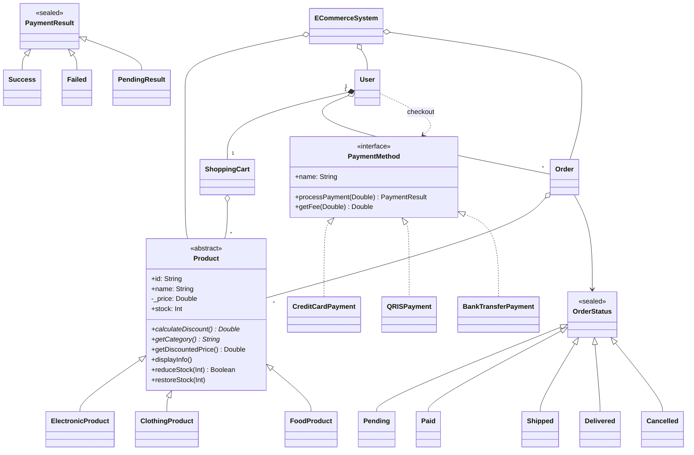

# LAPORAN TUGAS PRAKTIKUM OOP
## Sistem Manajemen E-Commerce

**Kelompok:** X

| No | Nama   | NIM   | Role   |
|----|--------|-------|--------|
| 1  | [Nama] | [NIM] | [Role] |
| 2  | [Nama] | [NIM] | [Role] |
| 3  | [Nama] | [NIM] | [Role] |

**Dosen Pengampu:** [Nama Dosen]  
**Mata Kuliah:** Pemrograman Berorientasi Objek (OOP)  
**Tanggal Pengumpulan:** [Tanggal]

---

## BAB I: PENDAHULUAN

### 1.1 Latar Belakang
Belanja daring melibatkan banyak jenis objek (produk, keranjang, pesanan, pembayaran, pengguna) yang saling berinteraksi. Paradigma OOP cocok untuk memodelkannya karena setiap konsep dapat menjadi kelas dengan tanggung jawab yang jelas. Tugas ini menerapkan empat pilar OOP pada studi kasus toko online menggunakan bahasa Kotlin.

### 1.2 Tujuan
1. Menerapkan **enkapsulasi** untuk melindungi data sensitif.
2. Menerapkan **pewarisan** untuk membangun hierarki produk.
3. Menerapkan **polimorfisme** dan **smart casting** untuk menangani berbagai tipe objek.
4. Menerapkan **sealed class** untuk status yang jumlah variannya terbatas.

### 1.3 Ruang Lingkup
Aplikasi berbasis konsol (tanpa database dan tanpa library eksternal) yang mencakup manajemen produk, keranjang, checkout, status pesanan, tiga metode pembayaran, diskon per kategori, dan laporan penjualan.

---

## BAB II: DESAIN SISTEM

### 2.1 Diagram Kelas

### 2.2 Deskripsi Kelas

| Kelas | Tanggung jawab |
|---|---|
| `Product` | Kelas induk abstrak: data dasar, stok, kontrak diskon & kategori |
| `ElectronicProduct`, `ClothingProduct`, `FoodProduct` | Aturan diskon dan atribut khusus tiap kategori |
| `ShoppingCart` | Menyimpan produk + jumlah, menghitung total, mereservasi stok |
| `OrderStatus` | Sealed class: Pending, Paid, Shipped, Delivered, Cancelled(reason) |
| `Order` | Pesanan hasil checkout; menyimpan salinan item; mengelola status |
| `PaymentMethod` / `PaymentResult` | Kontrak pembayaran dan hasilnya |
| `CreditCardPayment`, `QRISPayment`, `BankTransferPayment` | Validasi dan biaya tiap metode |
| `User` | Akun pengguna, autentikasi, keranjang, riwayat order, checkout |
| `ECommerceSystem` | Controller: produk, user, order, laporan penjualan |
| `CurrencyFormatter` | Utilitas format Rupiah |

**Aturan diskon**

| Kategori | Dasar | Tambahan |
|---|---|---|
| Elektronik | 5% | +10% premium; +5% garansi > 24 bulan |
| Pakaian | 10% | +15% seasonal; +5% ukuran XL/XXL/XXXL |
| Makanan | 5% | +20% organik |

---

## BAB III: IMPLEMENTASI

### 3.1 Product
Kelas abstrak dengan dua metode abstrak (`calculateDiscount`, `getCategory`) dan metode konkret (`getDiscountedPrice`, `displayInfo`, `reduceStock`, `restoreStock`, `updatePrice`). Harga disimpan di `_price` (private); subclass membaca lewat `protected val price`. `stock` memiliki `private set`. `equals/hashCode` memakai `id` karena `Product` dipakai sebagai key `Map` pada keranjang.

### 3.2 ElectronicProduct, ClothingProduct, FoodProduct
Mewarisi `Product`, meng-*override* `calculateDiscount()` dan `getCategory()`, serta memperluas `displayInfo()` dengan `super.displayInfo()` lalu menambahkan atribut khusus.

### 3.3 ShoppingCart
Memakai `mutableMapOf<Product, Int>` private. `addItem` memvalidasi jumlah dan stok; `removeItem` mengembalikan stok; `getItems()` mengembalikan salinan sehingga map asli tidak bocor. `clearAfterCheckout()` dan `releaseAll()` bersifat `internal`.

### 3.4 OrderStatus dan Order
`OrderStatus` adalah sealed class dengan `data object` dan `data class Cancelled(reason)`. `Order.status` hanya bisa diubah lewat `updateStatus()`, yang menolak perubahan bila status sudah final.

### 3.5 Payment
Interface `PaymentMethod` diimplementasikan tiga kelas dengan validasi dan fee berbeda (2%; 0,5%; 1% minimal Rp 5.000). Data sensitif (nomor kartu, CVV) bersifat private. Hasil dimodelkan dengan sealed class `PaymentResult`.

### 3.6 User
`password` bersifat `private` tanpa getter, hanya diverifikasi lewat `authenticate()`. `checkout()` memakai `when` exhaustive pada `PaymentResult`: sukses → order dibuat dan berstatus Paid, gagal → keranjang dipertahankan, pending → stok dikembalikan.

### 3.7 ECommerceSystem
Mengelola daftar produk, user, dan order; menolak ID produk/username duplikat; menyediakan `checkout()` yang mencatat order ke laporan penjualan.

*(Kode lengkap tersedia pada folder `src/` dan Lampiran.)*

---

## BAB IV: DEMONSTRASI

### 4.1 Output Program
Output lengkap ada di `docs/output_demo.txt`. Tempelkan minimal 10 screenshot dari hasil menjalankan `Main.kt`:

1. Daftar produk (6 produk, 3 kategori)
2. Keranjang user 1 beserta total diskon
3. Checkout gagal (CVV salah)
4. Checkout berhasil (kartu kredit) dan detail order
5. Keranjang user 2 setelah `removeItem`
6. Checkout QRIS
7. Checkout transfer bank
8. Update status order (termasuk penolakan status final)
9. Laporan penjualan
10. Demo polimorfisme, sealed class, enkapsulasi, smart casting

### 4.2 Analisis Skenario
- **Keranjang Budi:** Laptop Gaming (premium, garansi 36 bln) mendapat diskon 20% = Rp 3.000.000; 2 Jaket XL seasonal mendapat 30% = Rp 120.000 per unit. Total diskon Rp 3.240.000, total belanja Rp 12.560.000.
- **Checkout gagal lalu berhasil:** keranjang tidak hilang saat CVV salah, sehingga Budi bisa mencoba ulang.
- **Status final:** setelah `Delivered`, percobaan mengubah ke `Cancelled` ditolak.
- **Laporan penjualan:** order yang dibatalkan tidak dihitung dalam revenue (Total Revenue Rp 12.795.750 dari 3 order, 1 dibatalkan).

---

## BAB V: ANALISIS OOP

### 5.1 Enkapsulasi
| Lokasi | Mekanisme |
|---|---|
| `Product._price` | `private`, dibaca subclass lewat `protected val price`, diubah lewat `updatePrice()` yang memvalidasi |
| `Product.stock` | `private set`, diubah hanya lewat `reduceStock()` / `restoreStock()` |
| `User.password` | `private`, hanya `authenticate()` |
| `ShoppingCart.items` | `private`, `getItems()` mengembalikan salinan |
| `Order.status` | `private set`, diubah lewat `updateStatus()` |
| Data kartu/rekening | `private` pada kelas payment |

### 5.2 Pewarisan
Tiga kelas produk mewarisi `Product` dan memakai `override`, `super.displayInfo()`, serta properti `protected` induk. Perilaku bersama (stok, format, harga akhir) ditulis sekali di induk.

### 5.3 Polimorfisme
- `List<Product>` menampung tiga subclass; `calculateDiscount()` dan `displayInfo()` menjalankan versi subclass masing-masing (*dynamic dispatch*).
- `when (p) { is ElectronicProduct -> p.brand ... }` memakai *smart cast* sehingga atribut subclass dapat diakses tanpa cast eksplisit.
- `unknown as? FoodProduct` adalah *safe cast* yang menghasilkan `null` bila tipe tidak cocok.
- `OrderStatus.display()` dan `PaymentMethod.processPayment()` juga polimorfik.

### 5.4 Abstraksi
`abstract class Product` memaksa subclass mendefinisikan diskon dan kategori; `interface PaymentMethod` memisahkan *apa* yang dilakukan pembayaran dari *bagaimana* tiap metode melakukannya, sehingga metode baru dapat ditambahkan tanpa mengubah `User.checkout()`.

---

## BAB VI: KESIMPULAN

### 6.1 Kesimpulan
Seluruh fitur wajib terimplementasi dan program berjalan tanpa error. Empat pilar OOP diterapkan secara konsisten: data sensitif terlindungi, logika bersama terpusat di kelas induk, perilaku spesifik ditangani polimorfisme, dan sealed class membuat penanganan status/hasil aman karena kompiler memeriksa kelengkapan `when`.

### 6.2 Saran
1. Pembatalan order sebaiknya mengembalikan stok produk.
2. Password sebaiknya disimpan sebagai hash (bukan teks asli) pada sistem nyata.
3. Tambahkan unit test untuk aturan diskon dan alur checkout.
4. Tambahkan persistensi (database) dan antarmuka pengguna.

---

## LAMPIRAN: KODE LENGKAP
Lihat folder `src/` pada repository.

**Hormat kami,**  
[Nama Ketua Kelompok]
